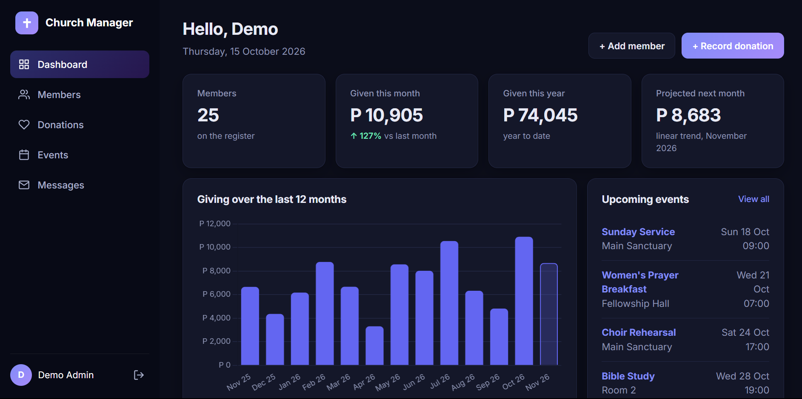
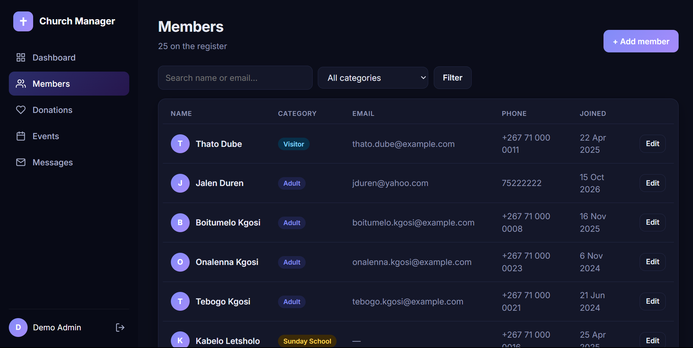
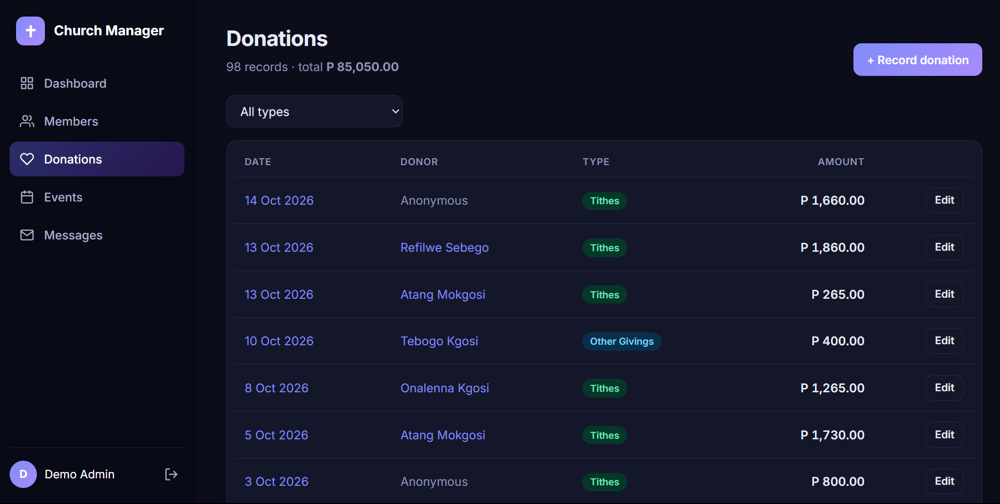

# Church Management System

A web app for running a small church's administration: keep a **member register**, record **donations**, plan **events**, and **email members**, with a **dashboard** that charts giving and projects next month's total.

Built with **Django 4.2** and **SQLite**. It began as coursework at Botswana Accountancy College and was later refactored and extended.

**Live demo:** https://tefokosie.pythonanywhere.com (sign in with `demo` / `demo-pass-123`; all data is fictional)

## Features

- **Login-protected**: every page requires signing in (Django authentication)
- **Members**: add, edit, delete, search and filter by category (Adult, Teen, Sunday School, Visitor)
- **Donations**: record tithes and other givings, optionally linked to a member; filter by type; running total
- **Events**: calendar of upcoming and recent events with date, time and location
- **REST API**: JSON endpoints for members, donations, events and a summary, with search, filters and pagination (see below)
- **Attendance**: tick who came to each event; the dashboard charts attendance over recent events and lists the most active members
- **Messages**: email a member from the app (emails print to the terminal in development)
- **Dashboard**: member and giving statistics, a 12-month giving chart, breakdowns by type and category, and a next-month projection using least-squares linear regression
- **Automated tests** for models, views, forms and the analytics calculations

## Screenshots

| Dashboard | Members |
|-----------|---------|
|  |  |



## Run it locally

You need Python 3.10 or newer.

```bash
# 1. Create and activate a virtual environment
python -m venv venv
venv\Scripts\activate          # Windows
# source venv/bin/activate     # macOS / Linux

# 2. Install dependencies
pip install -r requirements.txt

# 3. Create the database and fill it with fictional demo data
python manage.py migrate
python manage.py seed_demo

# 4. Start the server
python manage.py runserver
```

Open <http://127.0.0.1:8000> and sign in with **demo** / **demo-pass-123**.

To use the Django admin as well, create your own admin account: `python manage.py createsuperuser`, then visit `/admin/`.

## Run the tests

```bash
python manage.py test
```

## REST API

Built with Django REST Framework. Sign in first, then open `/api/` for the browsable API, or call it from a script with HTTP Basic authentication.

| Endpoint | Methods | Notes |
|----------|---------|-------|
| `/api/members/` | GET, POST, PUT, PATCH, DELETE | `?search=`, `?category=`, `?ordering=` |
| `/api/donations/` | GET, POST, PUT, PATCH, DELETE | `?type=`, `?member=<id>`, `?ordering=date` |
| `/api/events/` | GET, POST, PUT, PATCH, DELETE | `?upcoming=true`; includes `attendee_count` |
| `/api/summary/` | GET | Member count, giving totals, upcoming events |

```bash
curl -u demo:demo-pass-123 "https://tefokosie.pythonanywhere.com/api/members/?search=molefe"
```

## Project structure

| Folder | Purpose |
|--------|---------|
| `church_management/` | Project settings, URL routing, shared form and view helpers |
| `members/` | Member model, forms and views |
| `donations/` | Donation model, forms and views |
| `events/` | Event model, forms and views |
| `communications/` | Messages sent to members |
| `api/` | REST API: serializers, viewsets and routes |
| `analytics/` | Dashboard, calculations (`services.py`) and the `seed_demo` command |
| `templates/`, `static/` | HTML templates and CSS |

## Configuration

Settings are read from environment variables, with safe defaults for local use.

| Variable | Default | Meaning |
|----------|---------|---------|
| `DJANGO_SECRET_KEY` | dev-only key | Set a long random value in production |
| `DJANGO_DEBUG` | `1` | Set to `0` in production |
| `DJANGO_ALLOWED_HOSTS` | `localhost,127.0.0.1` | Comma-separated hostnames |
| `DEMO_MODE` | `1` | Show the demo login on the sign-in page; set `0` for real use |

## Notes

- All demo data is fictional, created by `seed_demo`.
- Currency is shown in Botswana pula (P).
